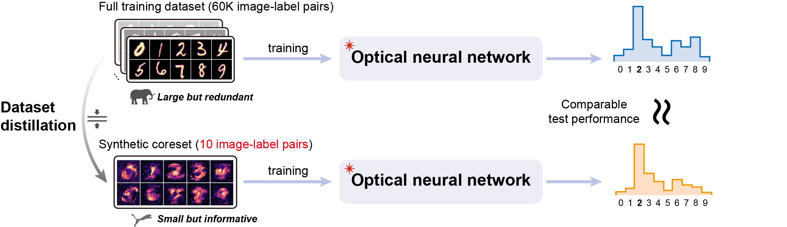

# Dataset distillation for optical neural networks

This repository contains the source code accompanying our paper, **“Dataset distillation for optical neural networks”**.

Datasets (`dataset/`) and experimental measurements (`experimental_results/`) are available on [Zenodo](https://zenodo.org/records/23684286).

## System requirements

Tested on Linux with Python 3.12.2, PyTorch 2.6.0 and CUDA 12.4. Package versions are listed in [requirements.txt](requirements.txt). Install them with `pip install -r requirements.txt`.

## Repository Contents

| Notebook | Results |
| --- | --- |
| [Exp_an](Exp_an.ipynb) | Summary and analysis of experimental results |
| [Exp1 — Fashion-MNIST](Exp1_FMNIST.ipynb) | Figure 2 |
| [Exp2 — Classification](Exp2_Text%2C%20graph%2C%20time-series%20classification.ipynb) | Figure 3 |
| [Exp3 — Regression and forecasting](Exp3_Regression_Forecasting.ipynb) | Figure 4 |
| [Exp4 — MZI mesh](Exp4_MZI_Adaptive_Retraining.ipynb) | Figure 5c; Supplementary Figures 4, 7 and 9 |
| [Exp4 — Reservoir](Exp4_reservoir_adaptive_training.ipynb) | Figure 5b |
| [SI](SI.ipynb) | Remaining supplementary figures and tables |

## Citation

If you find our code useful, please cite our paper, **“Dataset distillation for optical neural networks”**.
